# AI驱动LST：十图研究框架

十张16:9中文投研图，按“市场现状 → 需求机制 → 资金与供给 → A股映射”组织。

- **PNG**：4800 × 2700、300dpi，可直接放入PPT。
- **SVG**：矢量图，中文转路径，跨电脑查看不依赖本地字体。
- **PDF**：[十图合集](AI_LST_10_charts.pdf)。
- **代码与数据**：[Matplotlib绘图脚本](generate_charts.py)、[集中数据/假设](data.json)、[来源与口径](SOURCES.md)。

图2采用同版咨询历史估计；图3、5、6、7、8、9的比例、位置或消耗强度为已标注的假设/研究判断。投资情景为未来累计金额，时间跨度未指定。公司坐标不代表AI收入占比、客观排名或估值结论。

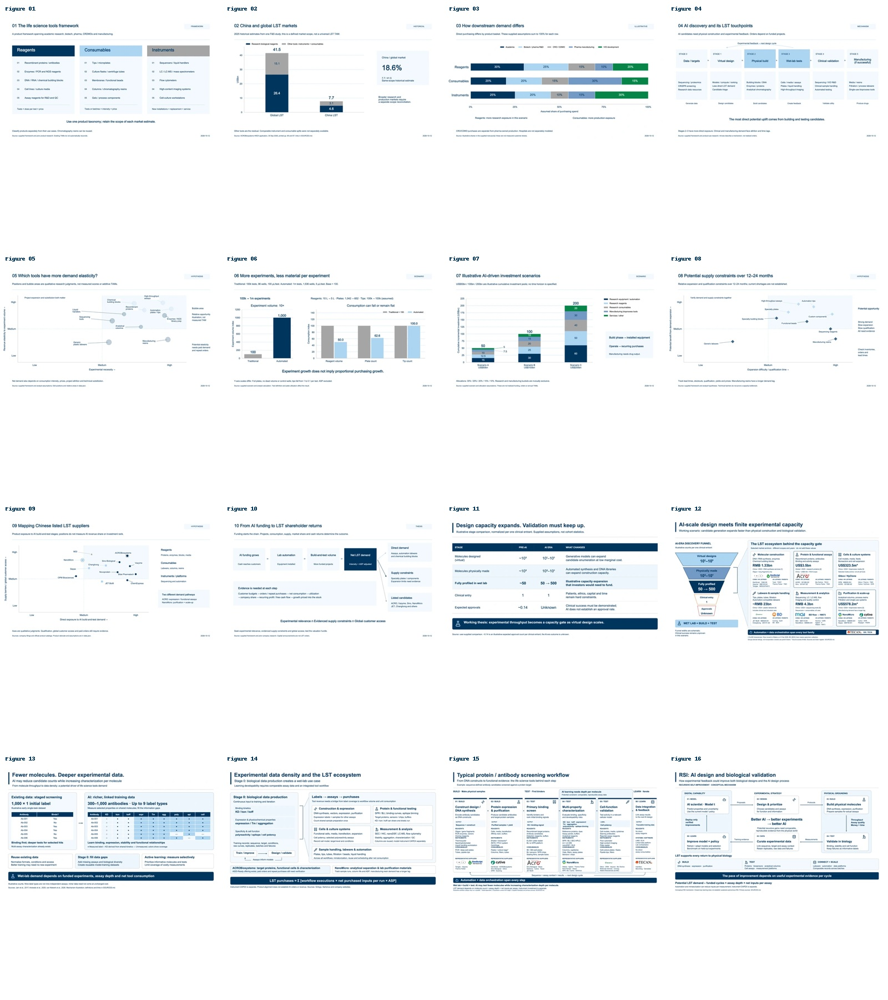

## 十张图

| 图 | 主题 | 高清PNG | 矢量SVG |
|---|---|---|---|
| 1 | 中国LST行业分类框架 | [PNG](png/01_lst_framework.png) | [SVG](svg/01_lst_framework.svg) |
| 2 | 中国与全球LST市场规模及结构对比 | [PNG](png/02_china_global_market.png) | [SVG](svg/02_china_global_market.svg) |
| 3 | 中国LST市场下游需求结构 | [PNG](png/03_downstream_structure.png) | [SVG](svg/03_downstream_structure.svg) |
| 4 | AI研发工作流与LST需求触点 | [PNG](png/04_ai_workflow.png) | [SVG](svg/04_ai_workflow.svg) |
| 5 | AI爆发后不同LST品类的需求弹性 | [PNG](png/05_demand_elasticity.png) | [SVG](svg/05_demand_elasticity.svg) |
| 6 | 自动化与微型化对单位实验消耗的影响 | [PNG](png/06_miniaturization.png) | [SVG](svg/06_miniaturization.svg) |
| 7 | AI驱动新增LST投资的情景分析 | [PNG](png/07_investment_scenarios.png) | [SVG](svg/07_investment_scenarios.svg) |
| 8 | 12–24个月潜在供给瓶颈地图 | [PNG](png/08_supply_bottlenecks.png) | [SVG](svg/08_supply_bottlenecks.svg) |
| 9 | A股LST公司在AI实验产业链中的映射 | [PNG](png/09_ashare_mapping.png) | [SVG](svg/09_ashare_mapping.svg) |
| 10 | AI驱动下LST行业投资逻辑总图 | [PNG](png/10_investment_logic.png) | [SVG](svg/10_investment_logic.svg) |

## 重新生成

Python 3.11或以上，安装依赖后运行：

```bash
python -m pip install -r requirements.txt
python generate_charts.py --data data.json --out .
```

代码不使用seaborn。所有数值、占比、公司/品类坐标均集中在`data.json`。中文字体自动查找；如果没有找到，请设置：

```bash
LST_CHART_FONT=/path/to/NotoSansCJK-Regular.ttc python generate_charts.py
```

Windows可把同名环境变量设为本机微软雅黑或思源黑体字体文件。仓库不分发商业字体文件。

## 图2口径调整

原文稿的占位值没有同口径市场依据。本版使用百普赛斯2026年港股申请文件中的2025年历史估计：全球41.5、中国7.7十亿美元；研究级生物试剂26.4与4.6十亿美元。其余工具按差额合并，**没有擅自将仪器与耗材硬拆为实际数据**。这不是所有广义LST的完整TAM。

## 核查

各行下游占比与投资分配合计100%；图6独立核算反应体积与整板数量；图2及图7堆叠合计核对。十图逐张检查中文字体、文字边界、标记可见性和标签重叠；详见`qa_report.json`。

研究框架版本：2026-10-12。详细来源页码及判断理由见[SOURCES.md](SOURCES.md)。

### 图1：中国LST行业分类框架

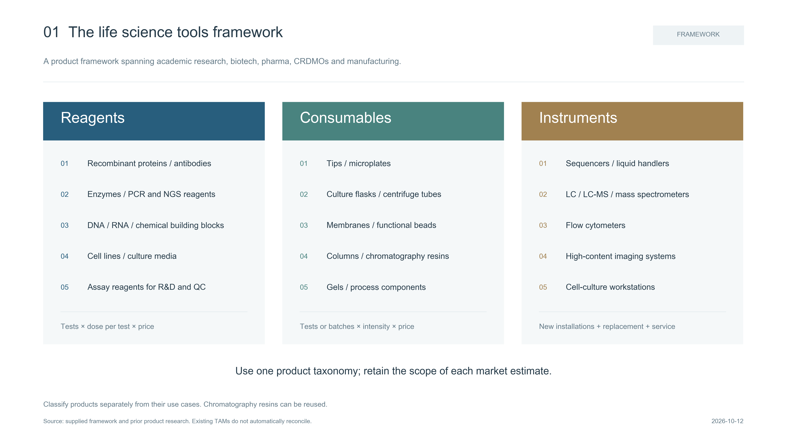

### 图2：中国与全球LST市场规模及结构对比

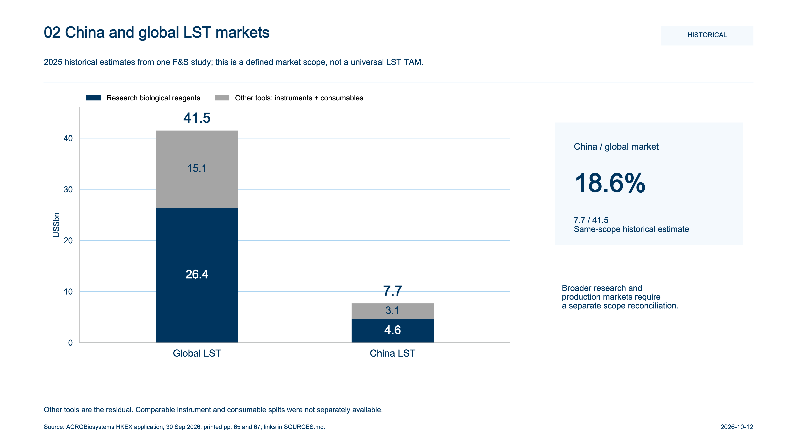

### 图3：中国LST市场下游需求结构

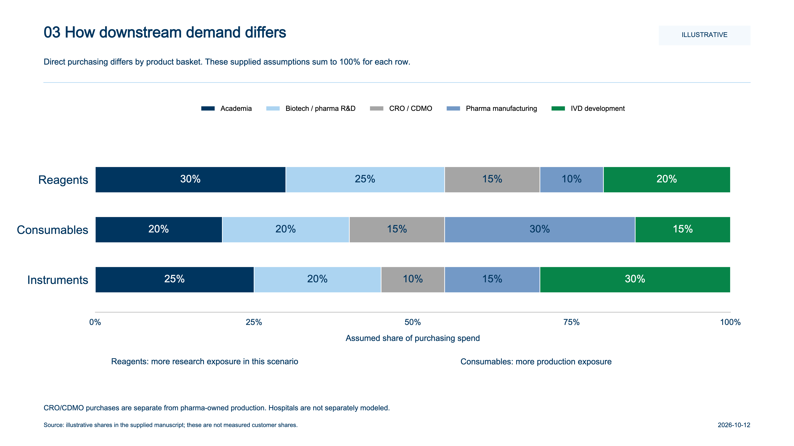

### 图4：AI研发工作流与LST需求触点

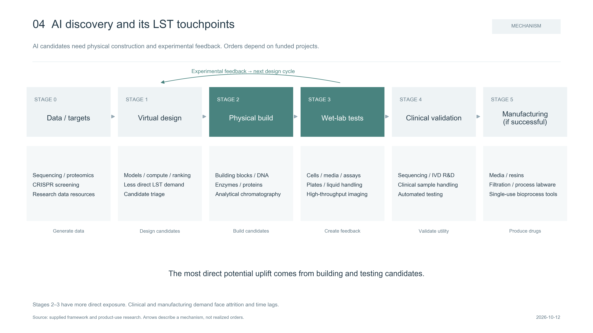

### 图5：AI爆发后不同LST品类的需求弹性

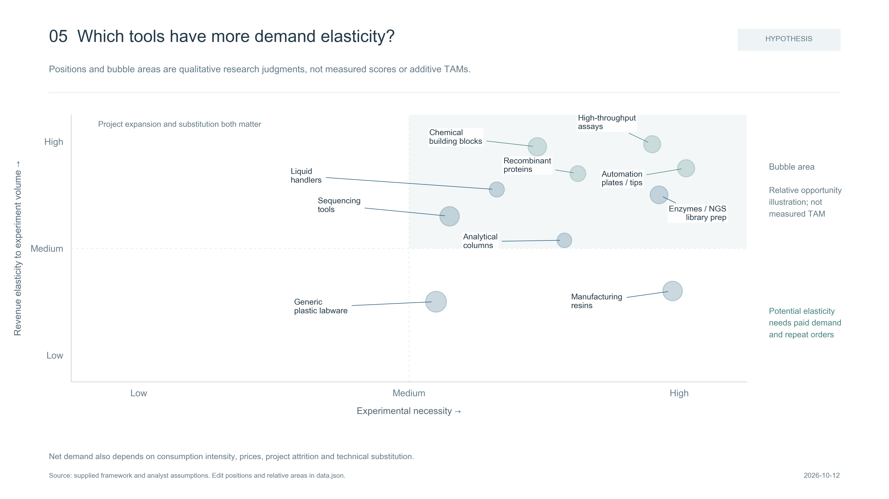

### 图6：自动化与微型化对单位实验消耗的影响

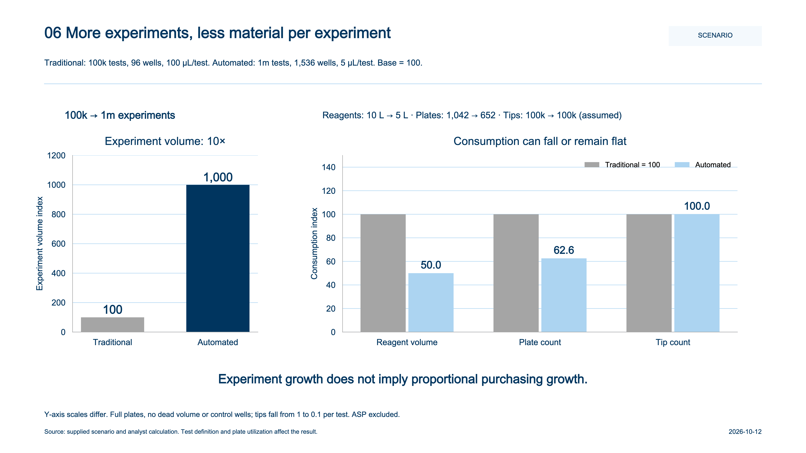

### 图7：AI驱动新增LST投资的情景分析

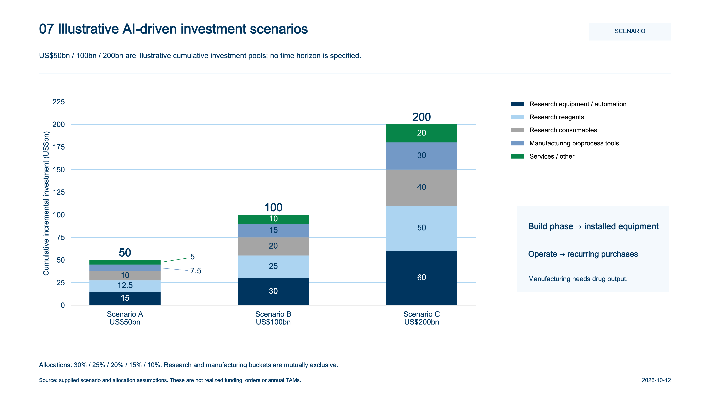

### 图8：12–24个月潜在供给瓶颈地图

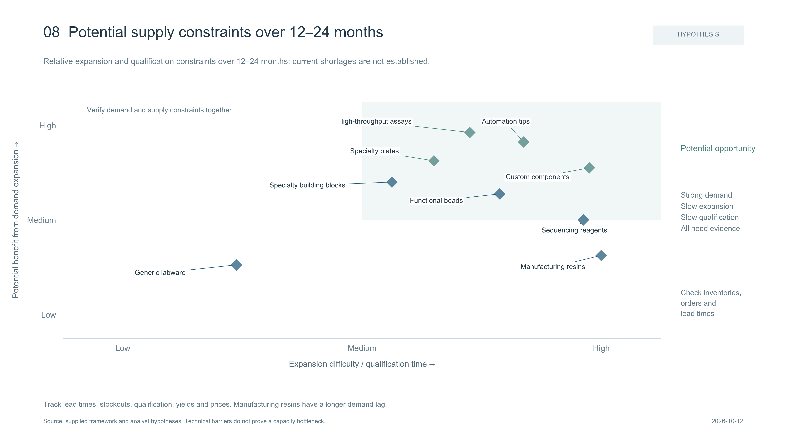

### 图9：A股LST公司在AI实验产业链中的映射

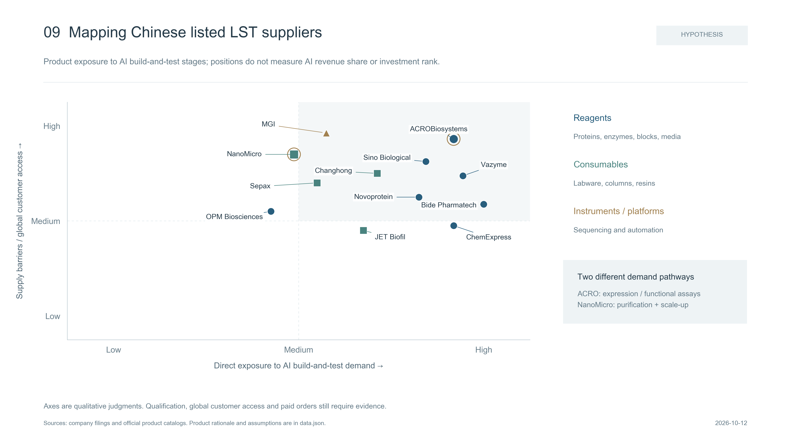

### 图10：AI驱动下LST行业投资逻辑总图

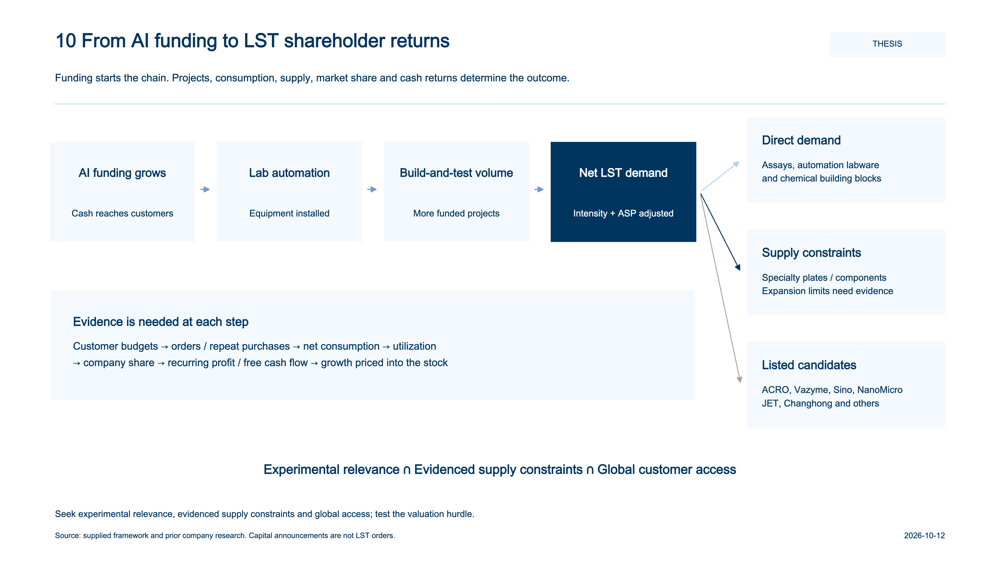
